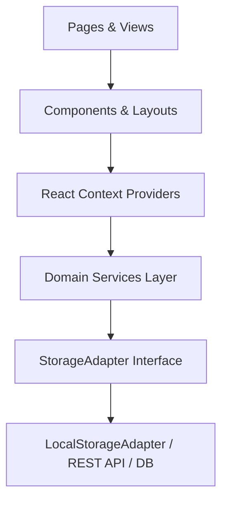

# Technical Architecture & System Design

## 1. Architectural Layers

The Vastramay frontend codebase is partitioned into distinct layers:

### Layer Breakdown

1. **Presentation Layer (`src/pages/`, `src/components/`)**:
   - `pages/storefront/`: Public-facing views (Home, Products catalog, Product Detail, Cart, Checkout, Wishlist, Account, Static policies).
   - `pages/admin/`: Admin operational console (Dashboard, Products, Orders, Customers, Settings).
   - `components/common/`: Shared UI primitives (Button, Input, Card, Badge, Modal, CartDrawer).
   - `components/layout/`: Storefront and Admin header, footer, sidebar navigation, and layout shells.

2. **State & Context Layer (`src/context/`)**:
   - `AuthContext`: Manages separate Customer and Admin sessions, roles, and profile states.
   - `CartContext`: Line items, quantity increments/decrements, live coupon validation, shipping computation, and slide-out drawer state.
   - `WishlistContext`: Customer-saved garments with quick add-to-bag capability.
   - `ToastContext`: Global notification queues with auto-dismiss timers.

3. **Domain Services Layer (`src/services/`)**:
   - `productService.ts`: Multi-faceted catalog queries, category/department filtering, dynamic facet calculation, and garment CRUD.
   - `orderService.ts`: Order placement, retrieval by customer, timeline inspection, and status updates (`confirmed`, `processing`, `shipped`, `delivered`).
   - `inventoryService.ts`: Variant-level stock adjustments, immutable audit logging (`inventory_movements`), and negative stock prevention.
   - `promotionService.ts`: Privilege coupon validation, percentage/fixed calculations, and minimum cart thresholds.
   - `customerService.ts`: Customer profile updates, address book management, and default delivery address selection.
   - `reviewService.ts`: Review curation, ratings aggregation, and moderation actions.
   - `settingsService.ts`: Store logistics thresholds, live announcement copy, and global demo factory reset.
   - `authService.ts`: Customer and role-guarded admin authentication simulation.

4. **Persistence Abstraction (`src/services/storageAdapter.ts`)**:
   - Defined by abstract repository interfaces in `src/types/repositories.ts` and `StorageAdapter`.
   - Current concrete implementation: `VersionedLocalStorageAdapter` implementing:
     - Schema envelope v2 wrapping (`{ schemaVersion: 2, timestamp, data }`).
     - Legacy schema payload migration.
     - JSON parse error catching and default seed recovery.
     - In-memory Map fallback for private browsing mode.
     - Credential security blacklist blocking sensitive keys (`password`).

---

## 2. Security Separation

- Client-side mock authentication is explicitly partitioned from production expectations.
- Passwords entered by users during demo login are never persisted in plain text.
- Production migration will point repository contracts to PostgreSQL and Supabase Auth / OAuth endpoints with HttpOnly session cookies. See `docs/BACKEND_MIGRATION_PLAN.md`.
