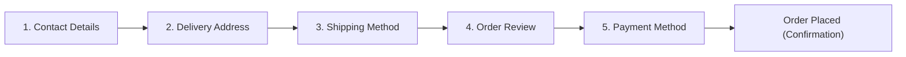

# Phase 07 — Checkout, Address Management & Customer Account

This document details the frontend architecture, simulated payment and authentication interfaces, Indian address validation system, immutable order snapshots, and customer account portal implemented for **Vastramay**.

---

## 1. Authentication UI & Architecture

Storefront customer authentication is managed through `AuthContext.tsx` and the unified `authService.ts`.

### Pages Implemented:
* **Customer Login (`/login`)**:
  * Email and password fields with real-time validation and accessible error announcements.
  * Remember device checkbox.
  * **Simulated Patron Quick-Fill Button**: Pre-fills `aarav.singhania@example.com` for rapid developer and reviewer testing.
  * Distinct links to "Create an Atelier Account" and "Forgot Password".
* **Customer Registration (`/register`)**:
  * Fields: First Name, Last Name, Email, Indian Phone (+91 with 10-digit validation), Password, Confirm Password.
  * Mandatory Terms of Service and Privacy Policy agreement checkbox.
* **Account Recovery / Forgot Password (`/forgot-password`)**:
  * Multi-step simulated recovery:
    1. Enter registered email address.
    2. Simulated 6-digit verification code dispatch (pre-populated with demo OTP `202688`).
    3. New password creation and confirmation.
* **Session Termination**:
  * Logout action clears the simulated session from `storageAdapter` (`customer_session`) and redirects safely to the storefront.

### Production Authentication Separation:
> [!IMPORTANT]
> Authentication is strictly simulated on the client side for development, UX review, and state persistence. In production:
> 1. Passwords must never be transmitted in plaintext or processed directly in the client.
> 2. Real authentication connects to OAuth2 / OpenID Connect providers (e.g. Auth0, Firebase, Supabase, or custom JWT backend) issuing `HttpOnly`, `Secure`, `SameSite=Strict` session cookies.
> 3. Administrative capabilities are isolated behind server-side Role-Based Access Control (RBAC).

---

## 2. Indian Address Management System

Addresses are stored and validated according to Indian postal and e-commerce standards in `src/utils/addressValidation.ts`:

### Validation Specifications:
* **Full Name**: Minimum 3 characters.
* **Mobile Number**: 10 digits starting with digits 6–9 (`/^(?:\+91|91|0)?[6-9]\d{9}$/`).
* **Postal PIN Code**: 6-digit Indian PIN code where first digit is non-zero (`/^[1-9][0-9]{5}$/`).
* **State / UT**: Standardized dropdown covering all 28 Indian States and 8 Union Territories.
* **Auto-City/State Lookup**: Entering a 6-digit PIN code automatically detects the metropolitan city and state (e.g. `400006` $\rightarrow$ Mumbai, Maharashtra; `110001` $\rightarrow$ New Delhi, Delhi; `560001` $\rightarrow$ Bengaluru, Karnataka; `221001` $\rightarrow$ Varanasi, Uttar Pradesh).

### Address Book Features:
* **Add / Edit Modal (`AddressModal.tsx`)**: Reusable modal for managing shipping and billing addresses.
* **Default Flags**: Individual toggles for `isDefaultShipping` and `isDefaultBilling`.
* **Classification**: Categorized as `Home`, `Office`, or `Other`.

---

## 3. Multi-Step Checkout Flow (`/checkout`)

The checkout experience in [CheckoutPage.tsx](file:///Users/jarvis/MySites/vastramay-3d/src/pages/storefront/CheckoutPage.tsx) provides a 5-step guided workflow:

### Steps:
1. **Contact Information**:
   * Email address for tracking notifications and mobile number for SMS dispatch alerts.
2. **Delivery Destination**:
   * Patrons can pick from saved address cards or click **+ Add Address** to launch `AddressModal`.
3. **Delivery Experience**:
   * **Standard Pan-India Dispatch**: Complimentary above ₹3,000 (3–5 business days, BlueDart Luxury Express, breathable muslin garment bag).
   * **White-Glove Atelier Express**: +₹450 surcharge (24–48 hour dispatch, gold-embossed keepsake box with custom cedar fragrance block).
4. **Order Review**:
   * Garments preview with variant sizes, colors, quantities, and itemized totals.
   * Real-time calculation using integer-paise math.
5. **Payment Method**:
   * Interactive demo simulation for UPI, Cards, NetBanking, and Cash on Delivery.

---

## 4. Simulated Payment Adapter (`paymentAdapter.ts`)

The payment adapter is clearly labeled as a client-side prototype:

* **UPI (Unified Payments Interface)**:
  * Accepts Virtual Payment Address (e.g. `name@okhdfcbank`) with quick-fill handles (`@okhdfcbank`, `@oksbi`, `@paytm`, `@ybl`).
  * Simulates dynamic QR code generation.
* **Credit / Debit Cards**:
  * Pre-configured test card autofill buttons:
    * *RuPay Platinum*: `6075 1234 5678 9010` (Exp: 12/28)
    * *Visa Infinite*: `4111 2222 3333 4444` (Exp: 08/29)
    * *Mastercard World*: `5555 4444 3333 2222` (Exp: 10/27)
  * Simulated CVV and expiry validation with artificial 1,200ms gateway handshake latency.
* **NetBanking**:
  * Bank selector covering major scheduled banks: HDFC Bank, State Bank of India, ICICI Bank, Axis Bank, Kotak Mahindra Bank, Punjab National Bank, Bank of Baroda, and IndusInd Bank.
* **Cash on Delivery (COD)**:
  * Policy rule: **Capped at ₹25,000**. Orders exceeding this threshold are blocked with an advisory to use online payment methods for high-value couture pieces.

---

## 5. Order Creation & Immutability

Orders created via `orderService.createOrder()` conform to strict immutability rules:

1. **Unique Order Numbering**:
   * Generated with pattern `VAST-[YEAR]-[4_DIGIT_ID]` (e.g. `VAST-2026-8812`).
2. **Immutable Snapshot**:
   * Purchased items, variant attributes, unit prices, discounts, delivery addresses, and payment references are deep-cloned into an immutable snapshot.
   * Modifying product catalog titles, prices, or variants in the future will **never** alter historical order records.
3. **Duplicate Submission Prevention**:
   * In-flight order signature guard (`idempotencySignature`) prevents accidental duplicate charges or double orders if the patron double-clicks the submission button.
4. **Milestone Timeline Tracker**:
   * Automatically initializes the tracking lifecycle:
     * *Order Placed & Confirmed*
     * *Atelier Tailoring & Quality Inspection*
     * *Handcrafted Packaging (Muslin bag & cedar block)*
     * *Dispatched with BlueDart Express (with tracking number)*
     * *Delivered (Doorstep signature handover)*

---

## 6. Customer Account Portal (`/account`)

The customer account portal in [AccountPage.tsx](file:///Users/jarvis/MySites/vastramay-3d/src/pages/storefront/AccountPage.tsx) is protected by `CustomerGuard` and includes:

* **Overview Tab**:
  * Royal Patron status card, quick metrics (Total Orders, Active Shipments, Saved Addresses, VIP Tier).
  * Latest order spotlight card with direct tracking shortcut.
* **Orders Tab**:
  * Status filter pills: *All*, *Confirmed*, *In Tailoring*, *Shipped*, *Delivered*, *Cancelled*, *Returned*.
  * Each card displays order number, date, status badge, items preview, total amount, and action triggers.
* **Order Detail Modal (`OrderDetailModal.tsx`)**:
  * Itemized receipt with unit prices and variant details.
  * Live timeline tracker showing milestone progress.
  * Simulated **Download Tax Invoice (PDF)** action.
  * **Order Cancellation**: Permitted while order is `pending` or `confirmed` (before departing the atelier).
  * **Order Return**: Permitted when order is `delivered` and within the 10-day complimentary return window.
* **Return Request Modal (`ReturnRequestModal.tsx`)**:
  * Garment selection with quantity selector.
  * Reason categorization (`sizing_issue`, `fabric_expectation`, `damaged`, `wrong_item`, `other`).
  * Real-time estimated refund calculation.
  * Patron agreement certifying unworn condition with craft security tags attached.
* **Address Book Tab**:
  * Saved address cards with `isDefaultShipping` and `isDefaultBilling` badges.
  * Edit, delete, and add new address modals.
* **Bespoke Measurements Tab**:
  * Stores personal measurements (Chest, Waist, Hip, Shoulder, Kurta Length, Sleeve Length in inches).
  * Re-asserts Vastramay's **2-Inch Internal Margin Guarantee**.

---

## 7. Security & Route Boundaries

| Boundary | Implementation Details |
| :--- | :--- |
| **Storefront Customer Guard** | `CustomerGuard.tsx` verifies customer session presence; redirects unauthenticated visitors to `/login?returnUrl=...`. |
| **Admin Panel Guard** | `AdminLayout.tsx` verifies admin user session (`admin_session`) and role permissions; customer sessions cannot access `/admin/*`. |
| **Secret Management** | No secret API keys, payment provider private tokens, or customer passwords exist in client source code. |
